<!--
  ============================================================
  README DE PERFIL — Sodré (NinjaZinS2)
  Repositório com o MESMO nome do usuário do GitHub.
  Arquivos na raiz: README.md, banner.svg, terminal.svg
  Onde você edita depois está marcado com  <!-- EDITE -->
  ============================================================
-->

  

 

<table border="0" cellspacing="0" cellpadding="0">
<tr>
<td width="44%" valign="top">

<h2>&gt; Sodré<code>_</code></h2>
<h3>Backend · Systems · Real-time Engineer</h3>

Projeto sistemas do zero e faço eles chegarem ao usuário. 
Redes, tempo real e segurança são onde eu moro.

🧩&nbsp; <b>arquitetura</b> e decisões técnicas são minhas 
🔌&nbsp; P2P · WebRTC · WebSocket · streaming em tempo real 
🔐&nbsp; criptografia E2E (ECDSA/ECDH) · superfície de ataque 
⚙️&nbsp; C++ de baixo nível · Python · empacotamento multiplataforma

</td>
<td width="56%" valign="top" align="center">

</td>
</tr>
</table>

<!-- ======================= COMO EU TRABALHO ======================= -->
> 🇧🇷 **Eu desenho a arquitetura, tomo os tradeoffs e faço o debug.** Uso IA como ferramenta — para
> acelerar a implementação e para me aprofundar rápido em domínios novos — mas o design do sistema e as
> decisões difíceis são minhas. A diferença aparece na hora de manter e depurar: os bugs que eu caço são
> os que só aparecem para quem entende o sistema de ponta a ponta (um *stream* que reinicia sozinho no
> Safari por causa de `Range`, uma separação de áudio comendo CPU no modo errado, uma race entre dois
> canais). Ferramenta boa acelera quem já sabe para onde está indo.
>
> 🇺🇸 **I own the architecture, the tradeoffs, and the debugging.** I use AI as a tool — to move faster on
> implementation and to ramp up quickly on unfamiliar domains — but the system design and the hard calls
> are mine. It shows when things break: the bugs I catch are the ones you only find when you understand
> the system end to end. Good tools speed up someone who already knows where they're going.

 

<!-- ======================= PROJETOS ======================= -->
## 🚀 Projetos · Selected work

<table border="0">
<tr>
<td width="50%" valign="top">

### 🎵 [Remix Player](https://github.com/NinjaZinS2/Remix-Linux)
`C++` · `raylib` · `miniaudio` · `redes`

Player de música multiplataforma. O interessante está por baixo: um **servidor HTTP embarcado** que
transforma o PC em fonte para o celular pelo navegador — com **streaming por `Range`/seek** (mapeando byte
para tempo no `ffmpeg`), pareamento por QR e autorização por aparelho. Fiz o **hardening**: proteção contra
**DNS rebinding** e **SSRF**, rate-limiting e injeção de argumento. O bot de Discord fala o **IPC na mão**
(protocolo binário, sem biblioteca).

🌐 servidor + streaming em tempo real · 🔐 superfície de ataque tratada · 🧩 núcleo em C++, um translation unit

</td>
<td width="50%" valign="top">

### 🕸️ Concord &nbsp;`repo privado`
`WebRTC` · `Web Crypto` · `P2P`

Chat/chamada **P2P sem servidor, num arquivo HTML só** — navegador a navegador. Identidade é um par de
chaves **ECDSA P-256** (o `nodeId` é o hash da pública), amigos com **key-pinning (TOFU)**, DM cifrada com
**ECDH ponta a ponta**. O reencontro depois de fechar a aba usa um mural público **cifrado e assinado**,
com o tópico derivado da chave do círculo e **rodando todo dia** — o mural nunca lê nada. Inclui voz, vídeo
e **transmissão de tela**.

🔑 identidade por chave, sem conta · 🛡️ rendezvous que preserva privacidade · 📡 mesh que se refaz sozinha

</td>
</tr>
<tr>
<td width="50%" valign="top">

### 🤖 [J.A.R.V.I.S](https://github.com/NinjaZinS2/jarvis-releases)
`Python` · `Multi-LLM` · `Windows`

Assistente de IA para desktop por voz, texto ou gestos. **Orquestra vários LLMs** (OpenAI, Groq, Gemini)
sobre um conjunto grande de ferramentas — controle do sistema, automação, mídia — com **memória
persistente**, motor proativo e **auto-atualização** versionada.

🧠 orquestração de agentes · 🔁 troca de modelo em tempo real · 📦 releases assinadas

</td>
<td width="50%" valign="top">

### 🧭 Como eu construo
`método`

Arquitetura no papel primeiro. Divido o sistema em camadas com fronteiras claras, decido os tradeoffs,
e só então implemento — usando IA para acelerar o código e pesquisar o que eu ainda não domino. Depois
**testo de verdade** (builds reais, casos de borda) e **depuro entendendo o sistema**, não por tentativa e
erro.

📐 design → build → teste real → debug de causa raiz

</td>
</tr>
</table>

 

<!-- ======================= STACK ======================= -->
## 🧰 Stack

 

<b>💪 O que eu faço bem · What I do well</b>

 

- **Sistemas & backend** — C++ de baixo nível (raylib/miniaudio), servidores embarcados, streaming em tempo real, concorrência (evitar deadlock em pipes/threads), empacotamento `.rpm`/`.deb`/AppImage e auto-update.
- **Redes** — P2P e WebRTC (mesh que se refaz sozinha), WebSocket, protocolos binários escritos à mão, HTTP com `Range`/seek.
- **Segurança** — criptografia ponta a ponta (ECDSA/ECDH), key-pinning (TOFU), tratamento de superfície de ataque (DNS rebinding, SSRF, injeção de argumento, rate-limiting).
- **Método com IA** — arquitetura e tradeoffs meus; IA para acelerar implementação e pesquisar domínios novos; debug por entendimento do sistema, não por tentativa e erro.
- **Ainda aprendendo** — sempre tem coisa nova pra dominar, e eu gosto disso.

<b>📊 GitHub stats</b>

 

<b>📫 Contato · Contact</b>

 

- 💬 **GitHub** — abra uma issue ou me siga: **[@NinjaZinS2](https://github.com/NinjaZinS2)**
<!-- EDITE (opcional): adicione só canais PROFISSIONAIS. Ex.:
- ✉️ **E-mail** — sodre.dev@exemplo.com  (crie um só para isso, não o pessoal)
- 💼 **LinkedIn** — https://linkedin.com/in/...
-->

 

<code>&gt;</code> primeiro a arquitetura, depois o código <code>_</code>

